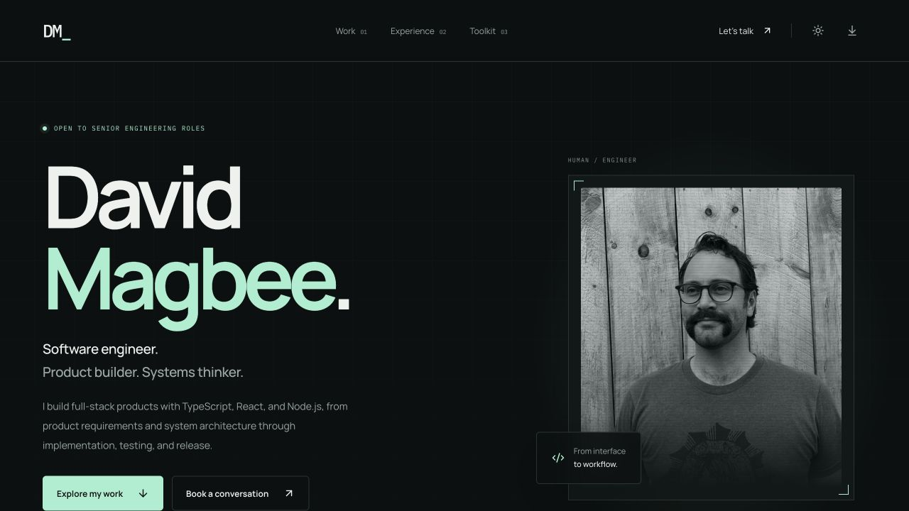

# David Magbee · Portfolio Dev

Original portfolio focused on full-stack product engineering, systems, and David’s direction toward AI engineering. A new codebase; the existing `portfolio-modern` site is maintained separately.



## Run

Node 24 is used in CI. Install from the lockfile:

```sh
npm ci
npm run dev
```

Open <http://127.0.0.1:3107>. For the production export:

```sh
npm run check
npm run build
npm run preview
```

`next build` exports complete HTML and assets into `out/`. No application server, CMS, database, API keys, or external font service is required. The interactive guide contains curated answers, not model-generated responses.

## Visitor experience

- Responsive work, experience, toolkit, direction, and contact sections.
- Light/dark themes: system preference on first visit; saved choice thereafter.
- Direct résumé viewing and PDF download.
- Existing Google appointment scheduler, linked directly to its verified booking listing.
- Project status filters, expandable engineering notes and career entries.
- Keyboard-accessible native guide dialog; reduced-motion and print styles.

## Content and provenance

Edit `data/profile.ts` for career, project, toolkit, and guide content. The supporting narrative and career direction live in `app/page.tsx`. The public résumé assets, `public/David-Magbee-Resume.pdf` and its DOCX companion, are unchanged copies of David’s approved originals. David confirmed the quantitative and outcome claims on November 13, 2026; the original “4.9/5 NPS” wording remains pending his metric-name clarification. See the content register for scope and provenance.

[Content sources](docs/CONTENT-SOURCES.md) distinguish source-reported career information, repository-backed project behavior, owner-stated goals, and remaining unknowns. Live project labels describe linked foundations; development-only features are called out in engineering notes. Authored webpage copy makes no quantitative performance claims; the downloadable résumé retains David’s separately confirmed claims.

[Reference audit](docs/REFERENCE-AUDIT.md) documents the Emmanuel portfolio’s mechanics and what informed this original implementation. No reference source code, portrait, résumé, AI endpoint, or activity proxy was copied. REA was reviewed; direct source inspection was sufficient.

## Verification and review

[Release notes, PR body, staging, and manual QA](docs/RELEASE.md). CI runs type checking and a production build. Browser verification is recorded separately from unverified third-party account/inbox flows.

The Sites hosting manifest in `.openai/hosting.json` points to an owner-private preview. It does not alter the public GitHub repository’s visibility or deploy to `davidmagbee.com`.
